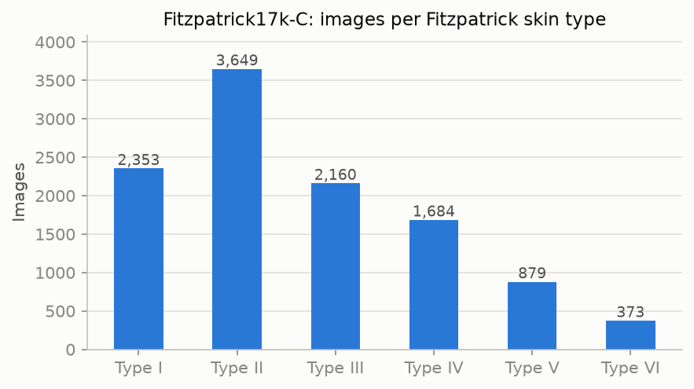
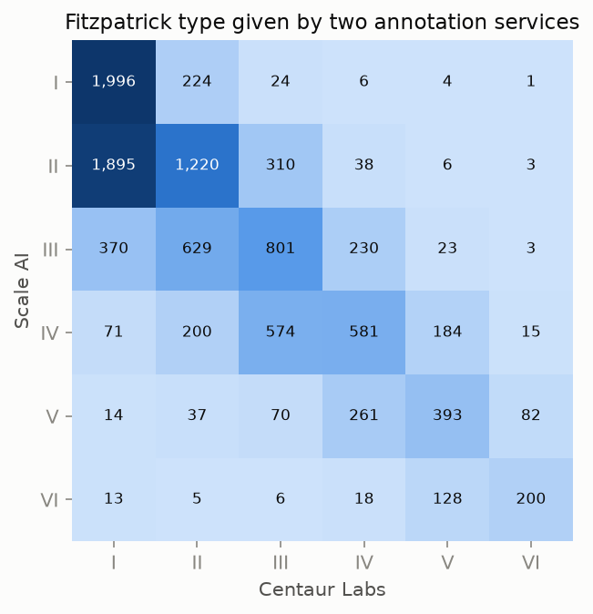

# Skin tone fairness

**Evaluating how skin disease classification performs across Fitzpatrick skin types**

Dermatology AI is mostly trained on images of lighter skin. This project measures whether a skin disease classifier performs worse on darker skin. It also tests how much of any gap comes from the skin-type mix of the training data rather than simply its size.

> **Research and education only.** Not a medical device and not for clinical use.

**Status:** the data analysis is complete (below). The model experiments are built and tested, and are waiting for the full image set, which has been requested from the dataset authors (see [Data access](#data-access)).

## Questions

1. Does a classifier trained on all skin types perform equally well on light (Fitzpatrick I–II), medium (III–IV) and dark (V–VI) skin?
2. If it is trained only on light skin, how much does performance on darker skin drop?
3. Is that drop caused by the *lack of diverse skin types*, or just by *less training data*?

## Scope

- **Images:** clinical photographs (not dermoscopy) from two online dermatology atlases, DermaAmin and Atlas Dermatologico, covering 114 skin conditions.
- **Task:** classify each image as **benign**, **malignant** or **non-neoplastic** (inflammatory, genetic and other conditions), the dataset's three-way grouping. The malignant-vs-rest decision is also analysed as a referral decision.
- **Skin tone:** measured with the Fitzpatrick scale. It was designed to classify how skin reacts to sun, not skin colour, and here it was estimated from photographs by crowd annotators. It is an imperfect proxy (see [Annotator agreement](#annotator-agreement)).

This is a companion to [MelanCare](https://github.com/i-oladele/melancare), which classifies dermoscopic images of pigmented lesions. That dataset (HAM10000) has no skin tone labels and is predominantly lighter skin, which motivates this project.

## Data

[Fitzpatrick17k](https://github.com/mattgroh/fitzpatrick17k) (Groh et al., 2021) contains 16,577 clinical images with Fitzpatrick skin type labels from two annotation services, Scale AI and Centaur Labs.

An independent audit (Abhishek et al., 2025) found duplicate images, train/test leakage and erroneous images in it. It released a cleaned version, **[Fitzpatrick17k-C](https://zenodo.org/records/12739457)**, with leakage-free train/validation/test splits. This project uses Fitzpatrick17k-C and its splits. It then excludes images with no skin type label (296) and images a dermatologist marked "wrongly labelled" (12).

| Step | Images |
|---|---:|
| Fitzpatrick17k | 16,577 |
| Fitzpatrick17k-C (duplicates and erroneous images removed) | 11,394 (31% removed) |
| With a Fitzpatrick skin type | 11,098 |

### Data access

Images are distributed as links to the original atlas websites. In November 2026, **every DermaAmin link tested was broken** (15 of 15 sampled; DermaAmin hosts 76% of the images), while most Atlas Dermatologico links still worked (14 of 15). The dataset authors provide the full image set on request. [`download_images.py`](scripts/download_images.py) handles both routes and checks every image against the MD5 fingerprint in the metadata, so images from any source are matched exactly.

### Skin type representation



| Skin type group | Benign | Malignant | Non-neoplastic | Total | Share |
|---|---:|---:|---:|---:|---:|
| I–II (light) | 824 | 934 | 4,244 | 6,002 | 54.1% |
| III–IV (medium) | 514 | 559 | 2,771 | 3,844 | 34.6% |
| V–VI (dark) | 125 | 130 | 997 | 1,252 | 11.3% |

Dark skin makes up 11% of the images, and there are only 130 malignant lesions on type V–VI skin in the whole dataset (about 22 in the test set). Any estimate of malignancy detection on dark skin will therefore carry wide confidence intervals. This scarcity is itself one of the problems the project highlights.

### Annotator agreement



For the 10,635 images typed by both services:

| Measure | Value |
|---|---:|
| Same Fitzpatrick type | 48.8% |
| Within one type | 91.3% |
| Same group (I–II / III–IV / V–VI) | 78.3% |
| Quadratic-weighted Cohen's kappa | 0.78 |
| Disagreements where Centaur Labs gave the lighter type | 79% |

The two services agree on the exact type for fewer than half the images, and their disagreements are **systematic**: Centaur Labs usually rates skin lighter. Which group an image falls into, and so any "performance on dark skin" figure, depends partly on who did the labelling. The analysis therefore repeats every skin-type result with the second annotator's labels, and with only the images on which both agree.

## Methods

**Model.** An ImageNet-pretrained EfficientNet-B0, fine-tuned on 224×224 images with a class-weighted loss. In the [MelanCare imbalance comparison](https://github.com/i-oladele/melancare#class-imbalance-comparison) this gave the best balanced accuracy. Augmentations are crops, flips and mild brightness/contrast changes. **Hue and saturation are deliberately not augmented**, because changing colour would alter apparent skin tone, the attribute under study.

**Three training-set compositions**, all evaluated on the same test set:

| Experiment | Training images | Purpose |
|---|---|---|
| A: all skin types | ~7,800 | Baseline: is performance equal across skin types? |
| B: light skin only (I–II) | ~4,200 | What happens when darker skin is absent from training? |
| C: all skin types, same size and diagnosis mix as B | ~4,200 | Separates *diversity* from *quantity*: B vs C differ only in skin types |

The validation set always contains all skin types, so model selection is identical across experiments.

**Evaluation**, for each skin type group:
- accuracy and balanced accuracy (benign / malignant / non-neoplastic);
- malignant-vs-rest AUC;
- sensitivity and specificity at **one referral threshold**, set on the validation set for 90% sensitivity across all skin types, as a deployed tool would use. A different threshold per group would hide the disparity;
- **95% bootstrap confidence intervals** within each group, plus a confidence interval for the **gap between light and dark skin**. A gap whose interval excludes zero is unlikely to be explained by sampling variation alone;
- **robustness checks**: the second annotator's skin types, and the subset where both annotators agree;
- results by image source (the two atlases differ in population and photography).

## Results

*Pending the full image set.* The pipeline has been tested end to end on the images that still download. Results will appear here as:
- a per-skin-type table for each experiment, with confidence intervals and light-vs-dark gaps;
- a comparison figure (point estimates with 95% CIs per skin type group, one colour per experiment).

## Limitations

- **Fitzpatrick type is a coarse, noisy proxy for skin tone.** It describes sun reactivity, was estimated from photographs, and the two annotators often disagree (see above).
- **Few dark-skin malignancies:** around 22 malignant test images on type V–VI skin, so malignancy results for this group are imprecise.
- **Atlas images are not clinic images.** They are curated, often show classic presentations, and come from two websites with different populations and photography. Skin type is entangled with source.
- **Diagnosis labels** come from the atlases and were not independently verified (except a small dermatologist-reviewed subset).
- **Single training run per experiment:** confidence intervals reflect test-set sampling, not run-to-run variation.

## How to run

**On Google Colab (recommended, free GPU):** [](https://colab.research.google.com/github/i-oladele/skin-tone-fairness/blob/main/notebooks/colab_experiments.ipynb)

Choose *Runtime → Change runtime type → T4 GPU*, paste the full-image link into `FULL_IMAGES_URL` if you have one, then *Runtime → Run all*.

**Locally:**

```bash
python3 -m venv .venv && source .venv/bin/activate
pip install -e ".[dev]"

# Labels
mkdir -p data/raw
curl -L -o data/raw/fitzpatrick17k.csv https://raw.githubusercontent.com/mattgroh/fitzpatrick17k/main/fitzpatrick17k.csv
curl -L -o data/raw/Fitzpatrick17k-C.csv "https://zenodo.org/api/records/12739457/files/Fitzpatrick17k-C.csv/content"

# Data overview (labels only, no images needed)
python scripts/explore_data.py

# Images: from the original links, or from the authors' archive
python scripts/download_images.py                       # original links (partial)
python scripts/download_images.py --archive images.zip  # full set from the authors
python scripts/prepare_data.py

# Experiments A, B, C
python scripts/train.py --run-name all_types
python scripts/train.py --run-name light_only --train-groups I-II
python scripts/train.py --run-name size_matched --size-match I-II
for r in all_types light_only size_matched; do python scripts/evaluate.py --run runs/$r; done
python scripts/compare_runs.py runs/all_types runs/light_only runs/size_matched \
    --names "A: all skin types" "B: light skin only (I-II)" "C: all skin types, same size as B" \
    --figure docs/figures/composition_comparison.png --out results/composition_comparison.md

pytest
```

## Project structure

```
src/skinfair/
  data.py        labels, skin type groups, metadata, dataset, augmentations
  metrics.py     sensitivity/specificity/AUC, bootstrap CIs, per-group CIs and gaps
  model.py       model construction and checkpoint loading
  engine.py      training and prediction loops
  plots.py       figures (colour-blind-checked palette)
scripts/         explore_data, download_images, prepare_data, train, evaluate, compare_runs
notebooks/       Google Colab notebook for experiments A-C
results/         data overview and (later) experiment results
docs/figures/    figures used in this README
tests/           unit tests (no images needed)
```

## References

- Groh M, et al. Evaluating deep neural networks trained on clinical images in dermatology with the Fitzpatrick 17k dataset. *CVPR Workshops* (2021).
- Groh M, et al. Towards transparency in dermatology image datasets with skin tone annotations by experts, crowds, and an algorithm. *Proc. ACM Hum.-Comput. Interact.* 6, CSCW2 (2022).
- Abhishek K, Jain A, Hamarneh G. Investigating the quality of DermaMNIST and Fitzpatrick17k dermatological image datasets. *Scientific Data* (2025). [Project page](https://derm.cs.sfu.ca/critique/).
- Daneshjou R, et al. Disparities in dermatology AI performance on a diverse, curated clinical image set. *Science Advances* 8, eabq6147 (2022).
- Fitzpatrick TB. The validity and practicality of sun-reactive skin types I through VI. *Archives of Dermatology* 124, 869–871 (1988).
- Tan M, Le Q. EfficientNet: rethinking model scaling for convolutional neural networks. *ICML* (2019).

Dataset licences: Fitzpatrick17k images CC BY-NC-SA 3.0; Fitzpatrick17k-C metadata CC BY 4.0.
